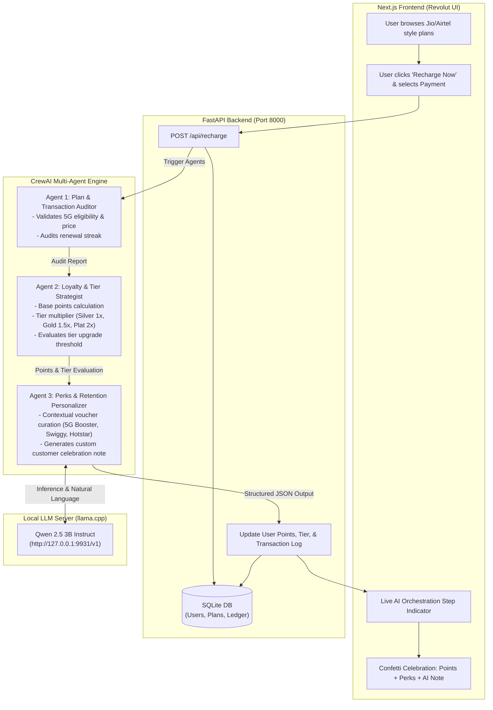

# Pulse Telecom: Multi-Agent AI Loyalty Engine

An agentic telecom recharge and loyalty reward system built for **Tech Mahindra**. It models realistic **Jio** and **Airtel** prepaid/5G plans, evaluates transactions dynamically through a **CrewAI multi-agent workflow** powered by **local Qwen 2.5 3B (via llama.cpp)**, and presents an ultra-clean **Revolut-styled Next.js** frontend.

---

## End-to-End Agentic Flow Architecture



---

## Multi-Agent Roles & Responsibilities

| Agent | Core Responsibility | Output |
| :--- | :--- | :--- |
| **Plan & Transaction Auditor** | Inspects purchased plan category (5G Unlimited, Entertainment, Annual), validates customer tenure, and verifies on-time renewal streak. | Transaction audit verification |
| **Loyalty & Tier Strategist** | Computes base points, applies tier multipliers (Silver 1.0x, Gold 1.5x, Platinum 2.0x), calculates streak bonus (+10 pts/month), and checks for tier upgrade. | Points breakdown and new tier |
| **Perks & Retention Personalizer** | Connects to local **Qwen 2.5 3B**, matches context-aware perk vouchers (5G boosters, Swiggy food passes, OTT passes), and writes a personalized retention celebration message. | Tailored perk codes and natural language note |

---

## Tech Stack

- **Frontend**: Next.js 14 (App Router), Tailwind CSS, Lucide Icons, Canvas-Confetti (Revolut fintech aesthetic).
- **Backend**: FastAPI (Python 3.12), SQLAlchemy, SQLite, Pydantic v2.
- **Agent Orchestration**: CrewAI (Sequential Process).
- **Local LLM**: Qwen 2.5 3B Instruct running on llama.cpp OpenAI-compatible server (`http://127.0.0.1:9931/v1`). Zero cloud API costs.

---

## Running Locally

### 1. Start Local LLM (llama.cpp)
Run your llama.cpp server on port `9931`:
```bash
curl http://127.0.0.1:9931/v1/chat/completions -H "Content-Type: application/json" -d "{\"model\":\"Qwen/Qwen2.5-3B-Instruct-GGUF:Q4_K_M\",\"messages\":[{\"role\":\"user\",\"content\":\"Hi\"}]}"
```

### 2. Start FastAPI Backend
```powershell
cd backend
.\venv\Scripts\python.exe run.py
```
- API Docs: `http://localhost:8000/docs`

### 3. Start Next.js Frontend
```powershell
cd frontend
npm run dev
```
- App: `http://localhost:3000`
